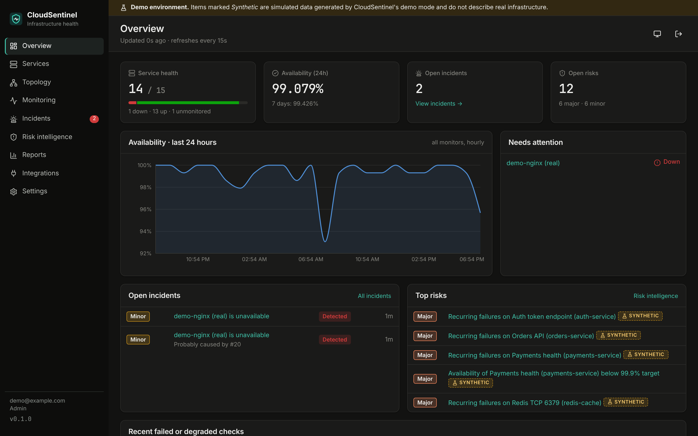
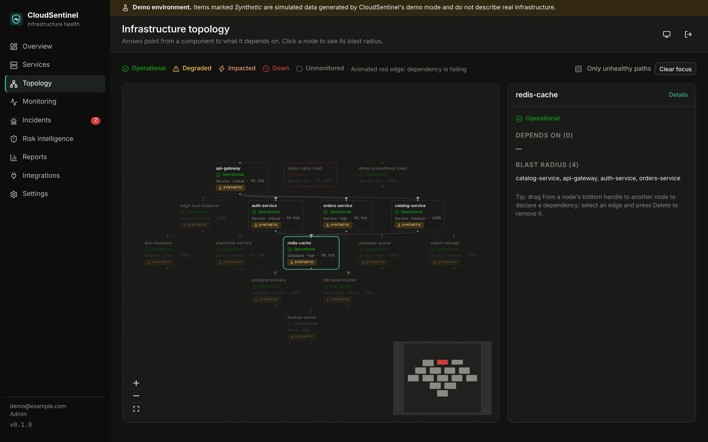
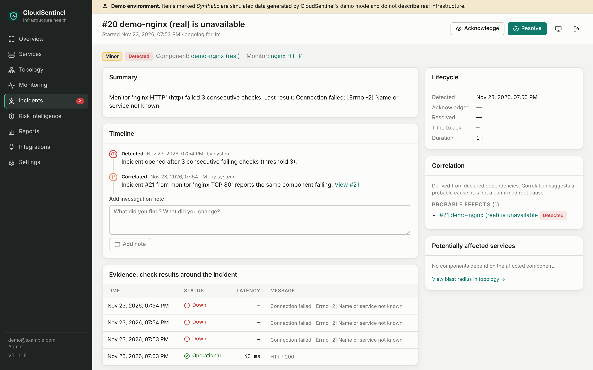
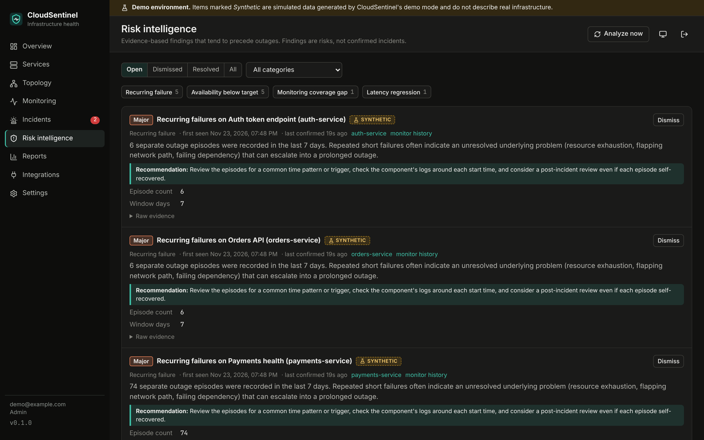
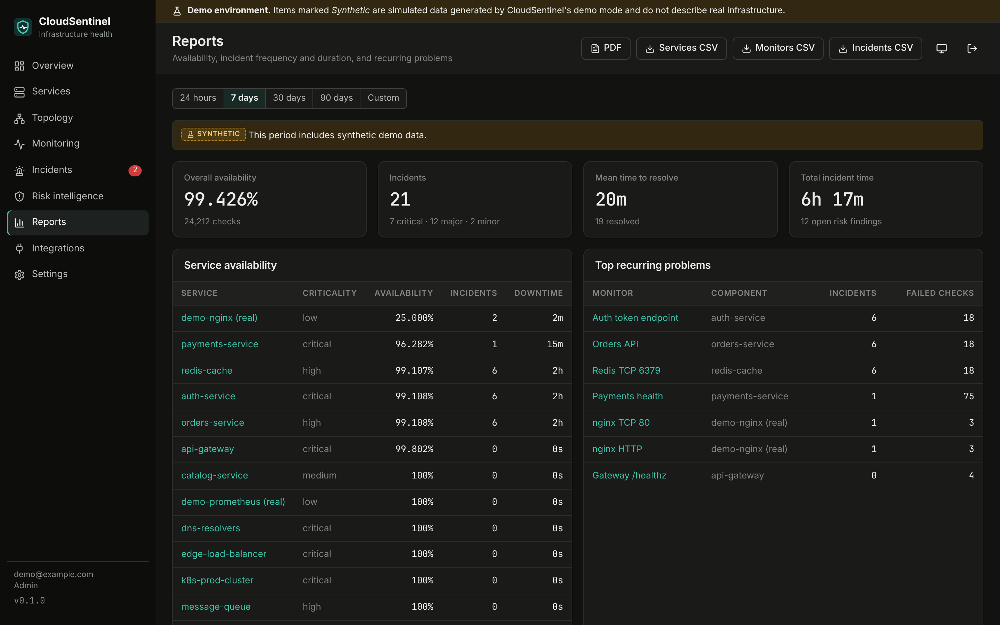

<p align="center">
  
</p>

<h1 align="center">CloudSentinel</h1>

<p align="center">
  <strong>Self-hosted, vendor-independent infrastructure health and availability intelligence.</strong><br />
  Know what is down, what it breaks, what happened — and what is likely to fail next.
</p>

<p align="center">
  <a href="https://github.com/mohamedkhaled139/CloudSentinel/actions/workflows/ci.yml"></a>
  <a href="LICENSE"></a>
  
  
</p>



## The problem

Infrastructure teams usually have plenty of *data* — uptime pings, Prometheus metrics, Kubernetes
events, host dashboards — spread across tools that each see one layer. During an outage the hard
questions are not answered by any single one of them:

1. **Is it available?** Across HTTP endpoints, ports, hosts, clusters and metrics, in one place.
2. **What is unhealthy or close to failing?**
3. **What depends on the broken thing?** Which services are impacted, and which alerts are just echoes?
4. **What happened, and when?** A timeline with evidence, not a wall of notifications.
5. **What will break next?** Recurring blips, creeping latency, restart loops, expiring certificates,
   blind spots in monitoring.

CloudSentinel answers those five questions for traditional data centres, private clouds, hybrid
environments and Kubernetes — without a SaaS dependency or vendor lock-in.

## What it does

| | |
|---|---|
| **Monitoring** | HTTP/HTTPS (status, content, latency, TLS expiry), TCP (connect, banner), Linux hosts via a tiny push agent, Prometheus queries with thresholds, Kubernetes API/nodes/workloads/pods. Configurable intervals, timeouts and failure/recovery thresholds; history with availability and response times. |
| **Dependency mapping** | Model services and infrastructure with owners and criticality, declare dependencies, and explore an interactive topology. Health propagates: a component whose dependency is down shows as **impacted**, with its blast radius. |
| **Incident intelligence** | Incidents open automatically after N consecutive failures, move through *detected → investigating → resolved*, and keep a chronological timeline with evidence, acknowledgements, notes and resolution notes. Related failures are grouped and linked as **probable** cause/effect via the dependency graph. |
| **Risk intelligence** | Evidence-backed findings with severity and recommendations: recurring failures, availability below target, latency regression, restart loops and reboots, expiring certificates, stale or inconclusive monitors, unmonitored critical components, unreachable integrations. Risks are never presented as incidents. |
| **Reporting** | Availability per service and monitor, incident count, MTTR and duration, top recurring problems for any date range; export to PDF and CSV. |
| **Extensible** | Providers and integration adapters are small Python classes; their configuration UIs are generated from JSON Schema, so new integrations need no frontend work. |

<table>
  <tr>
    <td></td>
    <td></td>
  </tr>
  <tr>
    <td align="center">Topology and blast radius</td>
    <td align="center">Incident investigation (light theme)</td>
  </tr>
  <tr>
    <td></td>
    <td></td>
  </tr>
  <tr>
    <td align="center">Risk intelligence</td>
    <td align="center">Reports with PDF/CSV export</td>
  </tr>
</table>

Screenshots are from the demo stack: items marked **Synthetic** are simulated demo data; the
`demo-nginx (real)` incident was produced by actually stopping a container.

## Quick start

### Try the demo (2 minutes)

```bash
git clone https://github.com/mohamedkhaled139/CloudSentinel.git
cd CloudSentinel
docker compose -f deploy/demo/docker-compose.yml up --build
```

Open <http://localhost:8000> and sign in as `demo@example.com` / `demo-password-123`. Then stop the
demo web server and watch a real incident open and resolve:

```bash
docker compose -f deploy/demo/docker-compose.yml stop web    # incident after ~90 s
docker compose -f deploy/demo/docker-compose.yml start web   # auto-resolves after recovery
```

### Run it for real

```bash
cp .env.example .env        # set CS_SECRET_KEY and POSTGRES_PASSWORD
docker compose up -d --build
```

Open <http://localhost:8000>; the first visit creates the administrator account. Put it behind your
HTTPS reverse proxy for production. Full guide: [docs/installation.md](docs/installation.md).

### Monitor a Linux host

Register an agent under **Integrations**, then on the host (Python 3.8+, no dependencies):

```bash
sudo CLOUDSENTINEL_URL=https://sentinel.example.com CLOUDSENTINEL_TOKEN=csa_... \
  python3 agent/cloudsentinel_agent.py --install
```

## How it works

```
Browser ─▶ FastAPI (REST + OpenAPI) ─▶ domain services ─▶ PostgreSQL / SQLite
Agents  ─▶      │                          ▲
                └── asyncio scheduler ──▶ providers: http · tcp · agent · prometheus · kubernetes
```

One container runs the API, the scheduler and the React console. Checks run concurrently with bounded
parallelism; results drive a per-monitor state machine that opens, correlates and resolves incidents;
a periodic analyser turns recorded history into risk findings. Read the
[architecture guide](docs/architecture.md) for details and trade-offs.

**Principles:** a broken data source is `unknown`, never `down` · correlation is labelled *probable* ·
every incident and finding links to its evidence · synthetic data is always labelled · status is
never conveyed by colour alone.

## Documentation

| | |
|---|---|
| [Installation & deployment](docs/installation.md) | Docker Compose, TLS, upgrades, backups, Kubernetes, source install |
| [Configuration](docs/configuration.md) | Environment variables and runtime settings |
| [Integrations](docs/integrations.md) | Provider reference and how to write a new integration |
| [REST API](docs/api.md) | Endpoints and examples (live OpenAPI at `/api/docs`) |
| [Architecture](docs/architecture.md) | Components, data model, status semantics, security model |
| [Development](docs/development.md) | Local setup, tests, migrations, conventions |
| [Demo data](docs/demo-data.md) | How synthetic data is generated and kept separate |
| [Roadmap](docs/roadmap.md) | Planned work and contribution opportunities |

## Project status

CloudSentinel **0.1** is a first public release: feature-complete for the scope above and covered by
automated backend (SQLite and PostgreSQL), frontend and agent tests, but not yet proven in large
production deployments. Known limitations:

* run a single scheduler per database (no leader election yet);
* no notification channels yet (email/webhook/Slack are next on the [roadmap](docs/roadmap.md));
* availability is computed from raw results — very long report ranges on large installations will be
  slower until rollups land.

## Contributing

Contributions are welcome — new integrations especially. Start with [CONTRIBUTING.md](CONTRIBUTING.md),
look for issues labelled `good first issue`, or pick an integration from the
[roadmap](docs/roadmap.md) (DNS and ICMP are good first providers). Please follow the
[Code of Conduct](CODE_OF_CONDUCT.md) and report vulnerabilities privately as described in
[SECURITY.md](SECURITY.md).

## License

[MIT](LICENSE)
